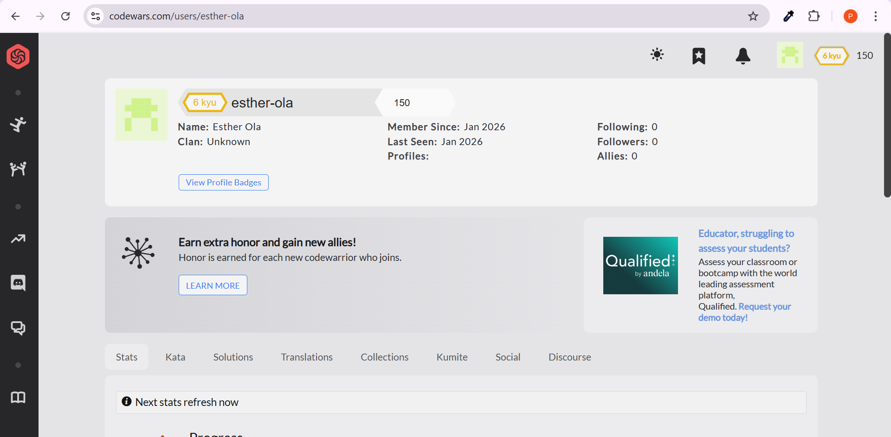

# CodeWars Assignment – README

I completed this assignment by solving CodeWars challenges as required.

## Objective

Earn **300 total points** on CodeWars:

- **150 points** from pre-selected beginner problems
- **150 points** from freely chosen problems

## Progress

- **150 points earned** from the **pre-selected beginner challenges**
- Problems covered basic programming concepts such as:
  - Loops
  - Conditionals
  - Strings
  - Arrays
  - Functions

## Proof of Completion

- A **screenshot of my CodeWars profile** showing the earned points has been added to the project files as proof of completion.

**File:** `CODEWAR-Point.png`

### Preview

You can also preview it directly below:

## Platform

CodeWars: [https://www.codewars.com/](https://www.codewars.com/)

## Notes

- Points earned are based on completed challenges.
- Some points may be automatically awarded by CodeWars for ranking up or other activities that was done.
- This submission confirms completion of the required **150 pre-selected points** of the tasks.

**Status:** ✔ Assignment requirement met (150 points). 
